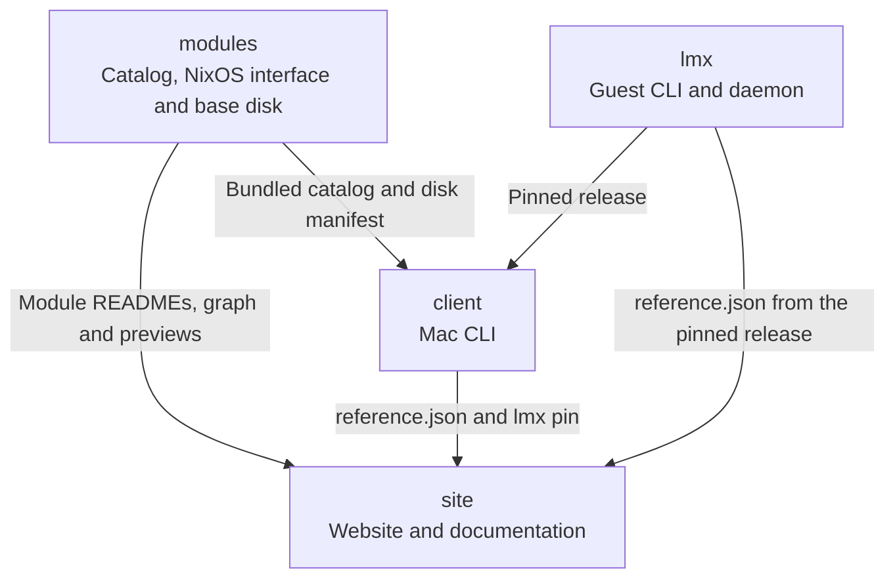

# Contributing

Open an issue or a pull request in the repository your change belongs to. Search
its issues and pull requests first.

Follow the
[Code of Conduct](https://github.com/limanix/.github/blob/main/CODE_OF_CONDUCT.md).
Report vulnerabilities privately through the
[security policy](https://github.com/limanix/.github/blob/main/SECURITY.md).

## Project map

| Repository | Holds | How to work on it |
| -- | -- | -- |
| [client](https://github.com/limanix/client) | `limanix`, the command on the Mac, and the model of `limanix.toml` | [Development](https://github.com/limanix/client/blob/main/README.md#development) |
| [lmx](https://github.com/limanix/lmx) | `lmx` and its daemon `lmxd`, inside every VM | [Development](https://github.com/limanix/lmx/blob/main/README.md#development) |
| [modules](https://github.com/limanix/modules) | The catalog of shells, toolchains and modules, its themes and prompts, and the base disk | [Development](https://github.com/limanix/modules/blob/main/README.md#development) and the [catalog contract](https://github.com/limanix/modules/blob/main/catalog/README.md) |
| [site](https://github.com/limanix/site) | limanix.dev and docs.limanix.dev | [Development](https://github.com/limanix/site/blob/main/README.md#development) |
| [.github](https://github.com/limanix/.github) | This guide, the security and conduct policies, the issue and pull request templates, and the organization profile | [Set up](#set-up) |

An arrow points from the repository that publishes something to the one that
reads it.

A client release bundles one catalog release: its modules, `interface.nix`,
`platform.nix`, `flake.lock` and the manifest of the base disk. It also pins one
`lmx` release in `internal/nixos/resources/base/lmx.json`. Every system the
client generates installs that `lmx` and `lmxd` and writes their configuration
and help cards to `/etc/lmx/config.json` and `/etc/lmx/help.json`. The client
then runs `lmx <command> --json` over SSH and reads the answer through a
versioned
[host contract](https://github.com/limanix/lmx/blob/main/contract/README.md).
[How it works](https://docs.limanix.dev/architecture) shows what runs where.

## Issues

**New issue** offers the same forms in every repository.

| Form | Use it for | Include |
| -- | -- | -- |
| Bug report | Behavior you did not expect | The versions, the smallest steps that reproduce it, and the logs, without credentials or private data |
| Feature request | A capability you miss | The problem and the use case first; a configuration or command example is optional |
| Documentation | Missing, unclear or outdated content | The page URL or file path |
| Question | How something works | What you are trying to do and what is unclear |

`limanix --version` on the Mac and `lmx version` in the VM show the versions.
The client's release page names the catalog it bundles.
[What the site reads](#what-the-site-reads) shows which repository owns a page
of the docs.

## Set up

Every repository uses [Task](https://taskfile.dev) 3.53.1 or newer
([installation](https://taskfile.dev/installation/)) and Docker: the `ci/*`
tasks run in the containers CI uses. In a repository directory, `task -l` lists
its tasks, and its README explains them under Development.

In `.github`, `task ci/markdown/fmt` checks the Markdown files and
`task markdown/fix` formats them.

## Pull requests

1. For anything beyond a small fix, open an issue first and agree on the
   approach before coding.
1. Keep a pull request to one change, with its tests and documentation.
1. Run the checks of the repository. Its Development section lists them.
1. Title it with a prefix from the table, such as
   `[fix] Go: put ~/go/bin on PATH`. A pull request merges by squash: the title
   becomes the commit on `main` and a line in the release notes.
1. Add a release label. If you cannot add one, a maintainer adds it during
   review.

| Release label | Title prefix | Section of the release notes |
| -- | -- | -- |
| `feature` | `[feat]` | Features |
| `bug` | `[fix]` | Bug fixes |
| `docs` | `[docs]` | Documentation |
| `tooling` | `[tooling]` | Tooling |
| `other` | `[other]` | Other |
| `deps` | None; Dependabot and the update flow write these titles | Dependencies |
| `skip` | None | Left out of the release notes |

A change to this list touches the labels of every repository, `labels.yml` and
`release.yml` in each of them, the pull request template and this guide.

In `client`, `lmx`, `modules` and `site`, a pull request can merge when:

- the required checks `gate` and `check label` pass; `check label` fails until a
  release label is applied;
- its branch is up to date with `main`;
- every review conversation is resolved.

Workflows of a first-time contributor's pull request wait for a maintainer to
approve them.

## Changes across repositories

Repositories read each other's published releases, not `main`. The client has no
catalog pin: its pull requests and releases build with the newest published
catalog. The order of a change matters.

| Change | Order | What fails meanwhile |
| -- | -- | -- |
| A catalog option, capability or metadata field that the client reads | Release the catalog, then merge the client pull request that uses it | A client pull request opened first fails against the old catalog. After the release, a `module.toml` field the client does not know stops client builds with `invalid module metadata` until that pull request merges |
| A new theme or prompt | Release the catalog. No client pull request is needed: a client takes them from the catalog it bundles | Nothing |
| The configuration `lmx` reads, `config.json` and `help.json` | Release `lmx`, then one client pull request moves the pin in `lmx.json` and writes the new field | `lmx` rejects unknown fields: a system that writes the field first fails to build |
| The host contract | Follow the [rules for changing it](https://github.com/limanix/lmx/blob/main/contract/README.md#change-the-host-contract). Release `lmx`, then one client pull request moves the pin and reads the change | A client stops on a version it does not read: `lmx answered with host contract N` |
| A new command, a new `limanix.toml` table or a new field in `reference.json` | Update `reference.json` with `task reference/fix`, release the project, then add the page in `site`. `lmx` reaches the site through the client that pins it | A site page that includes a region absent from the selected release fails with `no region`. New source fields and unused generated regions do not by themselves fail the site build |

To check a change before its release, build against your checkouts:
`modules_source=../modules` and `lmx_source=../lmx` in the tasks of `client`,
and `MODULES_ROOT`, `CLIENT_ROOT`, `LMX_ROOT` and `ORG_ROOT` in the docs build
of `site`.

### What the site reads

| On the site | Source | Version |
| -- | -- | -- |
| Module pages, the catalog graph, the previews of themes and prompts | `catalog/` and `previews/` in `modules` | The latest release |
| The reference of `limanix` and `limanix.toml` | `reference.json` in `client` | The latest release |
| The reference of `lmx` | `reference.json` in `lmx` | The release the latest client pins |
| This guide | `CONTRIBUTING.md` in `.github` | `main` |
| Every other page | `docs/pages` and `app/` in `site` | The tagged commit |

The site reads these when it builds, and it deploys only from a tag of `site`. A
release elsewhere reaches docs.limanix.dev with the next tag.

## Releases

| Repository | What starts a release | What it publishes |
| -- | -- | -- |
| `client` | A maintainer tags `v<version>` on `main` | Binaries built with the newest published catalog |
| `client` | Each catalog release | The newest client release again as `v<version>+<N>`, with that catalog. A client that cannot read the catalog fails the run and stays as it is |
| `lmx` | A maintainer tags `v<version>` on `main`, matching the version in `Cargo.toml` | Archives for `aarch64` and `x86_64` |
| `modules` | A tag `v<N>` on `main`. The Tag flow creates it when `flake.lock` or `catalog/_shared/unstable.toml` changes; a maintainer creates it for anything else | The catalog and its base disks, then the `modules-release` event to `client` |
| `site` | A maintainer tags `v<version>` on `main` | limanix.dev and docs.limanix.dev |
| `.github` | A merge to `main` | Takes effect on GitHub at once |

Release tags cannot be moved or deleted: fix a bad release with the next one.

## License

LimaNix projects are licensed under Apache-2.0. By contributing, you agree that
your contribution is licensed under the same terms.
